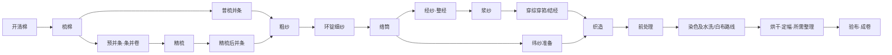

# 棉纺—机织—染整：设备、工艺与建模依据

资料核对日期：2026-11-16。配套数据：`process-data.json`。

## 范围与路线

- 范围：已轧花皮棉→棉环锭纱→机织坯布→匹染/整理→成品布。16个节点代表设备与工艺模块，不是所有订单都逐一经过的固定配方。

- 普梳路线：开清棉→梳棉→并条（一道或多道，按工艺）→粗纱→环锭细纱→络筒。

- 精梳路线：开清棉→梳棉→预并条→条并卷→精梳→精梳后并条→粗纱→环锭细纱→络筒。界面中的并条设备可在不同位置复用。

- 织造准备分为两路：经纱筒子→整经→浆纱→穿综穿筘/结经→织机；纬纱筒子按需要准备后直接供纬。

- 染整按产品选配：前处理→染色及充分水洗（白布可跳过染色）→烘干/定幅→所需机械或化学整理→验布。烧毛、丝光、轧光、预缩均需按品种组合。

- 橡胶毯预缩通过受控机械压缩改善经向残余缩水；它与轧光是不同工艺。预缩可作为后整理独立模块，不应以轧光代替。

- 模型为参考公开工艺资料制作的教学性概念模型，不是任何厂商的精确复刻、工程图或可投产设计。电机位置、尺度、数量及动画速度经过展示性简化。

本研究把生产路线抽象为16种设备模块。厂商资料用于核对工艺和主要结构，模型设计中的典型传动、电机位置及质量关注点属于工程性归纳；没有把样本机型的性能承诺移植到概念模型。

## 16个设备模块

### 01. 开清棉 · Opening & cleaning

**输入 → 输出：** 已轧花、打包的皮棉 → 混合均匀的小棉束。

把压实棉包逐步开松，混合配棉并清除杂质，为连续喂棉建立稳定料流。

**工艺：** 抓棉与称量配棉；逐级开松、混合与除杂；气流输送至梳棉喂棉箱。

**典型驱动：** 典型配置：变频电机驱动打手或开松辊；转速影响开松强度。 输棉风机与喂入驱动协同维持稳定供棉。

**质量关注：** 杂质去除与纤维损伤的平衡；配棉一致性、落棉与供棉波动。

**建模识别特征：** 棉包/抓棉臂、开松箱体、架空输棉管、外置风机与传动电机。

**路线说明：** 展示起点是皮棉，不包括种植、采棉和轧花；这些属于上游原料生产。

**依据：** [Rieter｜VARIOline 开清棉系统](https://www.rieter.com/products/systems/fiber-preparation/blowroom-line-varioline)；[Rieter｜短纤纺纱手册目录与工艺范围](https://www.rieter.com/services/expertise/the-rieter-manual-of-spinning/)。

### 02. 梳棉 · Carding

**输入 → 输出：** 松散棉束 → 生条（梳棉条）。

刺辊、锡林和盖板逐步分梳纤维，道夫把纤维网输出并汇成条。

**工艺：** 均匀喂入并经刺辊开松；锡林与盖板完成分梳和清除棉结；道夫剥取纤维网，集束后圈条入筒。

**典型驱动：** 典型配置：主电机带动锡林；喂入、道夫和圈条按工艺协调。 吸风单元排出尘杂；电机与皮带传动在模型侧面可见。

**质量关注：** 针布状态、梳理隔距；棉结、条子定量与条干均匀度。

**建模识别特征：** 大锡林、小刺辊与道夫、顶部盖板、出条喇叭口与条筒。

**依据：** [Rieter｜梳棉机部件与纤维路径](https://www.rieter.com/fileadmin/user_upload/products/documents/after-sales/parts/rieter-card-enhancements-brochure-en.pdf)；[Rieter｜短纤纺纱手册目录与工艺范围](https://www.rieter.com/services/expertise/the-rieter-manual-of-spinning/)。

### 03. 并条 · Drawing

**输入 → 输出：** 多根生条或精梳条 → 较均匀、伸直平行的棉条。

把多根棉条并合，通过前后罗拉速度差牵伸，改善均匀度与纤维平行度。

**工艺：** 条筒列喂入多根棉条；罗拉牵伸与自调匀整；出条、圈条并换筒。

**典型驱动：** 进给与输出驱动形成牵伸速度比；自调匀整系统按检测信号修正。 圈条、吸风与换筒各有驱动；本模型展示典型组合。

**质量关注：** 条干不匀与定量偏差；罗拉隔距、压力和自调匀整设定。

**建模识别特征：** 成列条筒、导条架、多对牵伸罗拉、紧凑机头与出条筒。

**路线说明：** 并条可以出现多次。精梳路线包含精梳准备中的预并条以及精梳后的并条；此节点代表设备类型，并非规定只做一道。

**依据：** [Rieter｜并条机官方技术手册](https://www.rieter.com/fileadmin/user_upload/products/documents/systems/spinning-preparation/rieter-draw-frames-brochure-3690-v1-100158-en.pdf)；[Rieter｜并条、精梳准备与粗纱设备](https://www.rieter.com/products/systems/spinning-preparation)。

### 04. 精梳 · Combing

**输入 → 输出：** 预并条后制成的棉卷 → 精梳条与精梳落棉。

在精梳路线中，先制备棉卷，再用钳板、圆梳和顶梳进一步去除短纤维与棉结。

**工艺：** 预并条后，经条并卷设备制成棉卷；多梳理头周期性夹持、梳理和分离接合；各头棉网汇合成条，随后再经并条。

**典型驱动：** 主驱动协调钳板、圆梳和分离罗拉的周期运动。 受控棉卷喂入维持稳定定量；具体传动随机型不同。

**质量关注：** 精梳落棉率与原料利用率；短绒、棉结与精梳条均匀度。

**建模识别特征：** 多组棉卷、周期钳持与梳理区、集条台、落棉吸风与条筒。

**路线说明：** 普梳纱可以跳过精梳；精梳纱的完整局部路线为：预并条→条并卷→精梳→精梳后并条。

**依据：** [Rieter｜E 90 精梳机](https://www.rieter.com/products/systems/spinning-preparation/comber-e-90)；[Rieter｜并条、精梳准备与粗纱设备](https://www.rieter.com/products/systems/spinning-preparation)。

### 05. 粗纱 · Roving

**输入 → 输出：** 并条后的熟条 → 带少量捻度的粗纱卷装。

把棉条进一步牵细，加少量捻度后卷绕，为环锭细纱提供便于输送的喂入卷装。

**工艺：** 熟条喂入牵伸区；锭翼加捻并引导粗纱；筒管卷绕、升降成形与落纱。

**典型驱动：** 典型配置：牵伸、锭翼、筒管及升降驱动协同控制。 锭翼与筒管的相对运动决定卷绕；电子牵伸可用于调整粗纱定量。

**质量关注：** 粗纱定量、捻度与张力；卷绕密度及筒管成形。

**建模识别特征：** 上部牵伸罗拉、两列锭翼、大粗纱筒管、升降龙筋。

**依据：** [Rieter｜F 40 / F 20 粗纱机](https://www.rieter.com/products/systems/spinning-preparation/roving-frame-f-40f-20/)。

### 06. 环锭细纱 · Ring spinning

**输入 → 输出：** 粗纱 → 细纱管纱。

通过精细牵伸获得目标线密度，利用锭子、钢领和钢丝圈形成捻度并卷绕管纱。

**工艺：** 粗纱架喂入与牵伸；锭子带动管纱，钢丝圈沿钢领运行形成加捻与卷绕；钢领板升降成形，满管后落纱。

**典型驱动：** 主驱动带动锭子传动系统；牵伸驱动控制输出速度及牵伸比。 钢领板升降和吸风分别驱动；模型不把钢丝圈误画为独立电机驱动。

**质量关注：** 纱支、捻度、条干和毛羽；断头、钢领钢丝圈状态及锭子振动。

**建模识别特征：** 长条双面机架、悬挂粗纱管、牵伸罗拉、密集锭子与钢领板。

**路线说明：** 本项目选环锭纺路线。转杯纺、喷气纺是替代路线，工序配置不同。

**依据：** [Rieter｜G 38 环锭细纱机](https://www.rieter.com/products/systems/ring-spinning-machines/ring-spinning-machine-g-38)；[Rieter｜短纤纺纱手册目录与工艺范围](https://www.rieter.com/services/expertise/the-rieter-manual-of-spinning/)。

### 07. 自动络筒 · Automatic winding

**输入 → 输出：** 细纱管纱 → 适合后续使用的筒子纱。

把小管纱卷成大筒子，检测并处理纱疵，接头后形成均匀、可稳定退绕的卷装。

**工艺：** 管纱退绕与张力控制；电子清纱、切除疵点与捻接；交叉卷绕成筒并自动落筒。

**典型驱动：** 单锭卷绕驱动带动槽筒或无槽筒导纱系统。 吸嘴、接头与落筒机构协同；卷绕张力和成形需匹配。

**质量关注：** 清纱门限与接头质量；筒子密度、成形和定长。

**建模识别特征：** 重复络筒单元、锥形筒子、下方管纱供给、清纱器和吸嘴。

**路线说明：** 筒子纱分成经纱与纬纱两路：经纱去整经浆纱；纬纱可经相应准备后送入织机，不经过经纱浆纱流程。

**依据：** [Rieter｜Autoconer X6 自动络筒机](https://www.rieter.com/products/systems/winding-machines/automatic-package-winding-machine-autoconer)；[Rieter｜Autoconer X6 卷绕与清纱部件](https://www.rieter.com/fileadmin/user_upload/products/documents/systems/winding/rieter-autoconer-x6-automatic-material-flow-type-d-v-brochure-3563-v1-98521-en.pdf)。

### 08. 整经 · Warping

**输入 → 输出：** 经纱筒子 → 平行排列的经轴纱层。

按设计根数、长度和排列，把筒子纱平行卷绕到经轴，建立均匀张力的经纱片。

**工艺：** 筒子架退绕并控制各纱张力；经导纱机构平行排列；按定长、张力与卷绕密度形成经轴。

**典型驱动：** 经轴电机调速以适应卷径变化；张力和制动控制影响均匀性。 筒子架张力器不等同于每个筒子都有电机；模型采用集中整经驱动。

**质量关注：** 总经根数、纱线次序与长度；片纱张力、断头及经轴密度。

**建模识别特征：** 大面积筒子架、梳状导纱架、宽经轴及挡盘、主驱动与控制台。

**路线说明：** 模型采用分批整经的概念布局；分条整经为另一种常用路线，尤其适合花色、短批量产品。

**依据：** [KARL MAYER｜WARPDIRECT 分批整经机](https://www.karlmayer.com/ecomaXL/files/KM_FS_WARPDIRECT_encn.pdf)；[CottonWorks｜机织前准备](https://cottonworks.com/learning-hub/weaving/preparation-for-weaving/)。

### 09. 浆纱 · Sizing

**输入 → 输出：** 整经轴上的经纱 → 上浆、烘干并卷成的织轴。

使浆料附着于经纱并烘干，提高经纱抵抗织造摩擦的能力，随后分纱并卷成织轴。

**工艺：** 多经轴合并为纱片；浸浆与轧浆控制上浆；烘燥、分纱与织轴卷绕。

**典型驱动：** 分区传动协调浆槽、烘筒与卷绕速度，控制伸长和张力。 浆泵和烘燥辅助设备另有驱动；热源与电机作用应分别理解。

**质量关注：** 上浆率与浆液均匀性；回潮率、伸长率和分纱效果。

**建模识别特征：** 经轴架、浆槽和双轧辊、多只烘筒、出纱梳与织轴。

**路线说明：** 是否上浆取决于纱线与织造要求；此主路线按常见短纤棉经纱展示。

**依据：** [KARL MAYER｜PROSIZE 浆纱工艺](https://www.karlmayer.com/ecomaXL/files/KM_FS_PROSIZE_en.pdf)；[CottonWorks｜机织前准备](https://cottonworks.com/learning-hub/weaving/preparation-for-weaving/)。

### 10. 穿综穿筘 · Drawing-in

**输入 → 输出：** 浆纱织轴与织造组织设计 → 穿过停经片、综丝和钢筘的经纱系统。

将经纱按组织次序穿过停经片、综丝和钢筘，使后续开口运动形成预定织物组织。

**工艺：** 分离、排序并检测单根经纱；按组织循环穿入停经片、综眼和筘齿；连同织轴及织造组件转运上机。

**典型驱动：** 自动穿经机以受控执行机构完成选纱、穿引和定位。 模型用伺服定位模块表达运动关系，不宣称特定厂商的内部轴系配置。

**质量关注：** 错综、错筘、双根和漏穿；色纱或捻向排列与设计一致性。

**建模识别特征：** 织轴移动小车、竖直综框组、横向钢筘、穿经头与导轨。

**路线说明：** 连续生产同组织品种时，可采用结经换轴；更换组织时按实际工艺穿综穿筘。

**依据：** [Stäubli｜SAFIR S80 穿综穿筘](https://www.staubli.com/global/en/textile/products/drawing-in-machine/safir-s80.html)；[CottonWorks｜机织前准备](https://cottonworks.com/learning-hub/weaving/preparation-for-weaving/)。

### 11. 机织 · Weaving

**输入 → 输出：** 织轴经纱 + 纬纱筒子 → 坯布。

开口、引纬和打纬循环交织经纬纱，送经与卷取共同维持张力和纬密。

**工艺：** 综框开口形成梭口；引纬机构把纬纱送过梭口；钢筘打纬，织轴送经与布辊卷取。

**典型驱动：** 主电机驱动主轴和打纬；现代机型可采用直接驱动。 电子送经与卷取驱动调节经纱张力和纬密，开口驱动随机型而异。

**质量关注：** 经纬断头、缺纬和双纬；经纱张力、纬密及布面疵点。

**建模识别特征：** 后方织轴、综框和钢筘、侧面主电机、前方布辊与纬纱供给。

**路线说明：** 本模型为机织原理示意；喷气、剑杆等引纬技术是设备选型分支。喷气引纬还需要压缩空气系统。

**依据：** [Picanol｜OmniPlus-i Connect 织机官方样本](https://www.picanol.be/sites/picanol/files/2024-09/PIC_Omniplus-i-Connect_brochure_2024_EN.pdf)。

### 12. 前处理 · Pretreatment

**输入 → 输出：** 带浆料与天然杂质的坯布 → 可均匀染色的准备布。

通过退浆、煮练和漂白等处理，去除影响润湿与染色的物质，获得所需吸水性和底白。

**工艺：** 按品种安排烧毛、退浆；煮练、漂白与反应停留；充分水洗、轧水，按下一步要求处理。

**典型驱动：** 导布辊分区调速维持低张力；轧辊驱动保障稳定布速。 循环泵、计量泵与排风机辅助液流和环境控制。

**质量关注：** 退浆效果、毛效和白度；幅宽、强力保留与均匀性。

**建模识别特征：** 连续浸渍水洗槽、蛇形导布辊、汽蒸反应箱、循环泵及管路。

**路线说明：** 烧毛和丝光依品种选配。丝光通常用于改善棉织物光泽、吸染及尺寸表现；实际工序顺序需配合产品与设备配置。

**依据：** [Benninger｜BEN-BLEACH 连续前处理](https://benningergroup.com/en/textile-finishing/bleaching-solutions)。

### 13. 染色与水洗 · Dyeing & washing

**输入 → 输出：** 前处理后的棉织物 → 达到目标色泽的染色布。

使染料均匀上染并完成固着，洗去未固着染料；本展示以平幅浸轧染色的设备逻辑为例。

**工艺：** 配液、计量和浸轧均匀给液；按所选染料及工艺完成堆置或连续固色；水洗、皂洗及后续脱水干燥。

**典型驱动：** 轧辊与导布辊同步；卷取或连续传动控制布面张力。 配液、循环和计量泵电机服务于稳定供液。

**质量关注：** 左右/前后色差与批差；固色效果、洗涤及摩擦色牢度。

**建模识别特征：** 染液槽、均匀轧液辊、堆置卷装或连续固色箱、后水洗模块。

**路线说明：** 冷轧堆（CPB）含卷装堆置时间，不能被动画理解为即进即出的瞬时固色。间歇浸染是另一条路线；白布可不染色。

**依据：** [Benninger｜BEN-Colour 连续与冷轧堆染色](https://benningergroup.com/en/textile-finishing/dyeing-solutions)；[Benninger｜机织物染色系统样本](https://benningergroup.com/fileadmin/user_upload/Textile_Finishing/Dyeing_Solutions/EN/Broschuere_Dyeing_EN.pdf)。

### 14. 拉幅烘干 · Stentering & drying

**输入 → 输出：** 湿态或待整理织物 → 达到目标幅宽、含湿率与整理状态的织物。

两侧针板或布铗控制布边，织物通过热风区完成烘干、定幅及所需整理焙烘。

**工艺：** 整纬、上针或上铗并控制超喂；链轨带布通过分区热风室；冷却与落布，检测幅宽和含湿率。

**典型驱动：** 链条与喂入驱动协调控制速度、张力及超喂。 循环风机和排风电机分别调节送风、循环及排湿。

**质量关注：** 幅宽、纬斜、克重和残余含湿率；热风均匀性与整理效果。

**建模识别特征：** 长型分区烘房、两侧链轨、循环风机及风道、入口轧车和出口落布。

**路线说明：** 纯棉主要关注烘干、定幅与整理焙烘；不要把它等同于涤纶等热塑性纤维的热定形机理。

**依据：** [Monforts｜MONTEX 拉幅机](https://www.monforts.de/en/products/stenters/)。

### 15. 轧光整理 · Calendering

**输入 → 输出：** 干燥并调湿的织物 → 获得平整度、光泽或纹理的织物。

织物通过受控压力的辊隙，利用压力、温度与辊面特征调整表面外观和手感。

**工艺：** 导布、调湿与张力控制；经过硬/软辊形成的轧点；冷却并卷绕或落布。

**典型驱动：** 主电机经传动系统驱动辊组；不同轧光方式可采用不同表面速度。 液压系统提供轧点压力，不能把压力作用等同于主电机转矩。

**质量关注：** 光泽、手感和布面压痕；轧点压力、温度与洗后效果。

**建模识别特征：** 竖直排列的轧辊、粗壮侧机架、侧面减速电机、液压加载组件。

**路线说明：** 轧光是可选外观整理，不等于预缩。棉织物若要求低洗涤缩水率，可另配橡胶毯预缩机；不同整理顺序按产品确定。

**依据：** [CottonWorks｜机械整理与轧光](https://cottonworks.com/learning-hub/finishing/mechanical-finishing/)。

### 16. 验布与成卷 · Inspection & rolling

**输入 → 输出：** 整理后的布匹 → 分等、记录并成卷的成品布。

在稳定走布与照明条件下检测布面疵点，结合质量检验记录分等，计长并卷装交付。

**工艺：** 展幅并以稳定张力走布；人工或机器视觉记录疵点位置；计长、分等、成卷与包装标识。

**典型驱动：** 牵引与收卷驱动随卷径和速度协调，避免拉伸或皱折。 编码器提供长度/位置反馈，检测装置与走布同步。

**质量关注：** 疵点分布、色差、幅宽与长度；质量计划中的克重、缩水及色牢度抽检。

**建模识别特征：** 倾斜验布台、照明/相机横梁、计长轮、收卷辊及传动电机。

**路线说明：** 在线布面检测不能替代所有物理化学实验室测试；验布也可设置在坯布与中间工序。

**依据：** [Uster｜织物在线与最终检验](https://www.uster.com/fileadmin/user_upload/Downloads/1_Products/1.4_Fabric_Inspection/Q-Bar/Uster_Fabric_Inspection_Q-Bar_brochure_web_en_23.pdf)。

## 选配工艺与辅助系统

烧毛去除表面突出纤维，丝光用于棉织物的吸染、光泽和尺寸表现。它们的配置取决于织物与成品要求，不能因为“全流程”而把所有整理视为必做项目。[Benninger 前处理与相关工艺](https://benningergroup.com/en/textile-finishing/bleaching-solutions)。

橡胶毯预缩是独立机械整理：受压缩的弹性毯带使织物产生受控收缩，以改善残余缩水。其可识别结构是橡胶毯、压辊/热滚筒、给湿与后烘干段。它不同于主要改变表面外观的轧光。[Monforts MONFORTEX](https://www.monforts.de/en/products/shrinkage-ranges/)。

实际工厂还配有空调与除尘、压缩空气、热源与换热、软化水与配液、水处理、实验室和物料搬运等系统。它们是工程设计所需的配套，本项目以主设备与驱动关系为展示主体；不推导公用工程负荷。

## 电机模型的结构依据

用于理解典型工业驱动结构；并非宣称所有纺机都采用同一种电机。

| 部件 | 作用与展示要点 |

|---|---|

| 机座与散热鳍 | 承载定子并提供散热表面。 |

| 定子铁心与绕组 | 通电后建立旋转磁场；外观用叠片和铜色端部绕组表达。 |

| 转子与输出轴 | 通过电磁作用产生转矩，将机械功输出到负载。 |

| 两端轴承 | 支承转轴并限制不必要的位移。 |

| 前后端盖 | 定位轴承并封闭机体端部。 |

| 冷却风扇与风罩 | 典型自扇冷结构引导空气流过机座；不是所有专用电机均有此部件。 |

| 接线盒与电缆入口 | 容纳电气连接，并与驱动柜连接。 |

| 底脚、紧固件与铭牌 | 固定电机并承载额定信息；本模型不虚构实际型号铭牌数值。 |

| 联轴器/带轮（外部传动） | 把轴转矩传到负载；按设备可使用直联、齿轮或皮带，并非电机内置件。 |

依据：[ABB 低压电机目录，Motor construction / Exploded view，页码104](https://library.e.abb.com/public/212f71af40014ca9bcd3788187292dbc/ABB%20Low%20voltage%20Process%20performance%20motors%20400%20V%2050%20Hz%2C%20460%20V%2060%20Hz_12-2022_v2.pdf)。

- 变频器调节驱动频率等量以控制适用电机的运行；具体控制方式取决于电机和驱动系统。

- 伺服驱动与反馈用于精确位置/速度协同。模型中的通用感应电机爆炸图不代表专用伺服或直驱电机的全部内部构造。

- 动画只表示运动关系，不表示额定转速、功率、同步相位或真实产能。

注意织机等专用装备可能采用直驱、独立送经/卷取或专用伺服。例如 Picanol 官方样本明确列有主机直驱与电子送经、卷取；因此不能把通用皮带模型当作所有织机的真实构造。[Picanol 官方样本](https://www.picanol.be/sites/picanol/files/2024-09/PIC_Omniplus-i-Connect_brochure_2024_EN.pdf)。

## 资料使用与可追溯性

所有来源均为设备厂家或 Cotton Incorporated 的 CottonWorks 公开资料。研究采用自行归纳的中文说明，不复制厂商图纸、照片或营销性能声明。CottonWorks 两个网页的全文抓取可能受站点访问控制影响，已通过可检索的官方页面内容核对；其余核心流程同时有设备厂商资料交叉支持。

| 来源 | 覆盖内容 |

|---|---|

| [Rieter｜短纤纺纱手册目录与工艺范围](https://www.rieter.com/services/expertise/the-rieter-manual-of-spinning/) | manual |

| [Rieter｜VARIOline 开清棉系统](https://www.rieter.com/products/systems/fiber-preparation/blowroom-line-varioline) | opening |

| [Rieter｜梳棉机部件与纤维路径](https://www.rieter.com/fileadmin/user_upload/products/documents/after-sales/parts/rieter-card-enhancements-brochure-en.pdf) | card |

| [Rieter｜并条机官方技术手册](https://www.rieter.com/fileadmin/user_upload/products/documents/systems/spinning-preparation/rieter-draw-frames-brochure-3690-v1-100158-en.pdf) | draw |

| [Rieter｜E 90 精梳机](https://www.rieter.com/products/systems/spinning-preparation/comber-e-90) | comber |

| [Rieter｜并条、精梳准备与粗纱设备](https://www.rieter.com/products/systems/spinning-preparation) | prep |

| [Rieter｜F 40 / F 20 粗纱机](https://www.rieter.com/products/systems/spinning-preparation/roving-frame-f-40f-20/) | roving |

| [Rieter｜G 38 环锭细纱机](https://www.rieter.com/products/systems/ring-spinning-machines/ring-spinning-machine-g-38) | ring |

| [Rieter｜Autoconer X6 自动络筒机](https://www.rieter.com/products/systems/winding-machines/automatic-package-winding-machine-autoconer) | wind |

| [Rieter｜Autoconer X6 卷绕与清纱部件](https://www.rieter.com/fileadmin/user_upload/products/documents/systems/winding/rieter-autoconer-x6-automatic-material-flow-type-d-v-brochure-3563-v1-98521-en.pdf) | windDrive |

| [KARL MAYER｜WARPDIRECT 分批整经机](https://www.karlmayer.com/ecomaXL/files/KM_FS_WARPDIRECT_encn.pdf) | warp |

| [CottonWorks｜机织前准备](https://cottonworks.com/learning-hub/weaving/preparation-for-weaving/) | warpPrep |

| [KARL MAYER｜PROSIZE 浆纱工艺](https://www.karlmayer.com/ecomaXL/files/KM_FS_PROSIZE_en.pdf) | size |

| [Stäubli｜SAFIR S80 穿综穿筘](https://www.staubli.com/global/en/textile/products/drawing-in-machine/safir-s80.html) | drawingIn |

| [Picanol｜OmniPlus-i Connect 织机官方样本](https://www.picanol.be/sites/picanol/files/2024-09/PIC_Omniplus-i-Connect_brochure_2024_EN.pdf) | weave |

| [Benninger｜BEN-BLEACH 连续前处理](https://benningergroup.com/en/textile-finishing/bleaching-solutions) | pre |

| [Benninger｜BEN-Colour 连续与冷轧堆染色](https://benningergroup.com/en/textile-finishing/dyeing-solutions) | dye |

| [Benninger｜机织物染色系统样本](https://benningergroup.com/fileadmin/user_upload/Textile_Finishing/Dyeing_Solutions/EN/Broschuere_Dyeing_EN.pdf) | dyePDF |

| [Monforts｜MONTEX 拉幅机](https://www.monforts.de/en/products/stenters/) | stenter |

| [CottonWorks｜机械整理与轧光](https://cottonworks.com/learning-hub/finishing/mechanical-finishing/) | calender |

| [Monforts｜MONFORTEX 橡胶毯预缩](https://www.monforts.de/en/products/shrinkage-ranges/) | shrink |

| [Uster｜织物在线与最终检验](https://www.uster.com/fileadmin/user_upload/Downloads/1_Products/1.4_Fabric_Inspection/Q-Bar/Uster_Fabric_Inspection_Q-Bar_brochure_web_en_23.pdf) | inspect |

| [ABB｜低压电机结构与爆炸图（2022样本）](https://library.e.abb.com/public/212f71af40014ca9bcd3788187292dbc/ABB%20Low%20voltage%20Process%20performance%20motors%20400%20V%2050%20Hz%2C%20460%20V%2060%20Hz_12-2022_v2.pdf) | motor |
